 

## Hi, I'm Karan 👋

Developer and mechanical engineer in Canada. I like things that run on your own machine,
Linux on the desktop, Bluesky, and cats. Most of what I build is some mix of those.

## 🍷 vino

Your laptop probably has an AI chip in it that nothing uses. These put it to work, and nothing leaves your machine.

- **[vinoWhisper](https://github.com/karanshukla/vinoWhisper)**: live captions for whatever is playing, plus hold-a-key dictation.
- **[vinoSpeak](https://github.com/karanshukla/vinoSpeak)**: text in, speech out.
- **[vinoSearch](https://github.com/karanshukla/vinoSearch)**: find files by what is in them. "dog watching the sunset" finds the photo.
- **[vinoPop](https://github.com/karanshukla/vinoPop)**: highlight some text, get a little bar of useful buttons. PopClip, but Linux.
- **[vinoAuthFace](https://github.com/karanshukla/vinoAuthFace)**: unlock your laptop with your face.
- **[vinoWatch](https://github.com/karanshukla/vinoWatch)**: a tray icon that shows what all of the above are costing you.
- **[ovfetch](https://github.com/karanshukla/ovfetch)**: the boring plumbing that makes the rest install cleanly.

## 🦋 Bluesky

- **[kodamachi](https://github.com/karanshukla/kodamachi)** · [kodamachi.app](https://kodamachi.app): get anonymous questions, answer them on your Bluesky feed.
- **[kodamachi-feed](https://github.com/karanshukla/kodamachi-feed)**: the custom feed that goes with it.
- **[php-atproto-identity](https://github.com/karanshukla/php-atproto-identity)**: a small library for the PHP folks who want to build on AT Protocol too.
- **[bluejays.space](https://github.com/karanshukla/bluejays-space)**: fake Blue Jays headlines. Not affiliated with MLB, or with reality.

## 🏠 Self-hosted

- **[OpenResto](https://github.com/karanshukla/openresto)** · [openres.to](https://openres.to): restaurant bookings you can run yourself. One Docker command, no third-party services.

## 🐧 Linux desktop

- **[waydroid-tray](https://github.com/karanshukla/waydroid-tray)**: a tray icon for Waydroid, because it never had one.
- **[karanshukla.ca](https://github.com/karanshukla/karanshukla.ca)**: my site. It shows what I'm listening to and writes its own changelog.

## 🐱 Cats

- **[asher-cli](https://github.com/karanshukla/asher-cli)**: check on the Litter-Robot from the terminal, with animated ASCII cats. Named after the cat.
- **[sportsbook-meow](https://github.com/karanshukla/sportsbook-meow)**: replaces betting ads in sports streams with cats. In real time.

## 📦 Installable bits

[PyPI](https://pypi.org/user/karanshukla/) · [crates.io](https://crates.io/users/karanshukla) · [npm](https://www.npmjs.com/~karanshukla) · [Packagist](https://packagist.org/users/karanshukla/)

Everything is MIT unless a repo says otherwise. I also write sometimes, over on <a href="https://karanshukla.ca">karanshukla.ca</a>.

